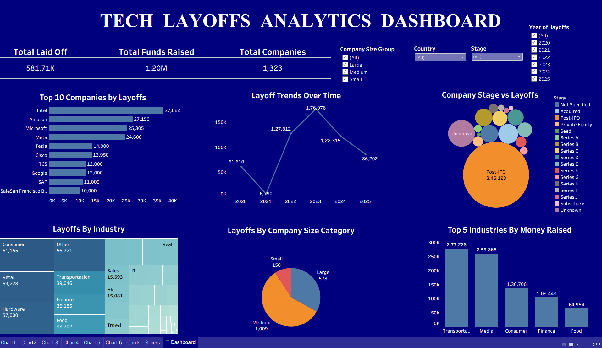

#  Tech Layoffs Analysis using Tableau

##  Project Overview
This project analyzes technology industry layoff data from 2022 to 2025 using Tableau. The dataset was cleaned and prepared for analysis to explore layoffs across companies, industries, and funding stages. Interactive visualizations were developed to communicate patterns and trends in the data.

##  Project Objectives
- Analyze layoff patterns from 2022 to 2025.
- Explore layoffs across industries and companies.
- Examine funding-related patterns in the dataset.
- Compare key metrics across available categories.
- Present findings through interactive Tableau visualizations.

## 🛠️ Tools & Technologies
- **Tableau:** Data visualization and dashboard development.
- **Calculated Fields:** Creating derived analytical metrics.
- **ZN() Function:** Handling null values in calculations.
- **Data Cleaning:** Removing unnecessary columns and preparing data.
- **Interactive Visualizations:** Exploring data across categories.

##  Dataset Used
The project uses a technology industry dataset covering the period from 2022 to 2025. It contains company and industry-related information, funding amounts, and funding stages.

##  Key Insights
- Identified the top five industries by total money raised.
- Compared funding amounts across industry categories.
- Explored differences between funding stages.
- Used calculated fields and data cleaning techniques to prepare the data for visualization.

## 📊 Dashboard Preview

##  Conclusion
This project demonstrates practical skills in data cleaning, calculated fields, data preparation, and interactive visualization using Tableau. It provides a visual overview of technology industry data from 2022 to 2025 and highlights patterns across industries and funding stages.

##  Author
Aswathi A

